# Red Pitaya + LM1875 current source

A programmable current source for loads of a few ohms, built in November 2026 to drive a small
Helmholtz coil: DC to ~80 kHz, up to 2 A peak, continuous or in triggered bursts. It measures its own output current and voltage all the time (with some small problems though). In qudi it is the
hardware module `RedPitayaLM1875CurrentSource` in this folder.

## The circuit

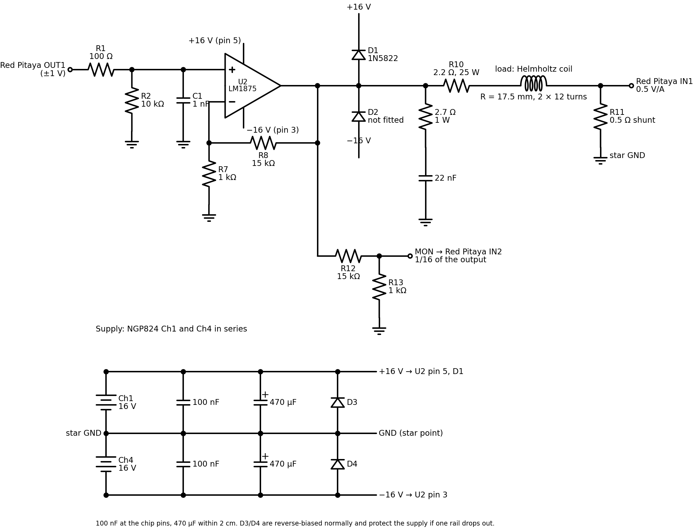

(`figures/schematic.py` draws it with schemdraw; edit and rerun it when the board changes.)

A Red Pitaya (RP2) generates a voltage waveform on OUT1 (±1 V). An LM1875 power op-amp amplifies
it 16 times on ±16 V rails. The output drives R10, the load and a 0.5 Ω shunt (R11) to ground.
RP2 reads the shunt voltage on IN1 and 1/16 of the amplifier output on IN2 (MON).

| Part | Why |
|---|---|
| R1, C1 (100 Ω, 1 nF) | 1.6 MHz low-pass: keeps RF and DAC steps out of the amplifier (3° at 80 kHz) |
| R2 (10 kΩ) | holds the input at 0 V when the cable is unplugged |
| U2 LM1875 | DC-coupled power op-amp, 4 A internal limit, thermal shutdown at 170 °C. Stable only at gain ≥ 10 |
| R8, R7 (15 k, 1 k) | gain 1 + R8/R7 = 16, also at DC (no capacitor in the feedback). Chosen so the ±13 V the output can swing on ±16 V rails needs 0.81 V on OUT1 |
| D1 (1N5822), D2 not fitted | clamp inductive spikes into the rails; the LM1875's internal diodes cover the negative side |
| Zobel (2.7 Ω + 22 nF) | ~3 Ω load above ~3 MHz against HF oscillation; draws only 0.13 A at 80 kHz and full output |
| R10 (2.2 Ω, 25 W, wirewound) | without it the 0.28 Ω coil would turn mV of offset into tens of mA; also takes the DC heat away from the coil |
| R11 (0.5 Ω, 1 %, thick film, own heatsink) | 0.5 V/A, so the ±1 V input covers ±2 A. Low-side, so ground-referenced; Kelvin leads to the IN1 coax |
| R12, R13 (15 k, 1 k) | MON = output/16, so ±13 V fits the ±1 V input. The 15 k isolates the output from the cable capacitance |
| 100 nF + 470 µF per rail | 100 nF at the pins, 470 µF within 2 cm: local charge for the 2 A current pulses |
| D3, D4 | protect the supply (NGP tolerates 0.4 V reverse) when one rail drops out |

Margins at full drive: the output swings to about ±13 V (rail − 3 V). A 13 V sine at 80 kHz
needs 6.5 V/µs, 81 % of the LM1875's typical slew rate (8 V/µs). The heatsink (Wakefield 657-25
with fan) takes ≈ 8 W at 1 A and 80 kHz.

**It is a voltage amplifier, not a current source with feedback.** The current follows from the
load: I(f) = gm(f) · OUT1, where gm(f) is the measured transconductance of this amplifier with
this load. For the Helmholtz coil, gm is 4.73 A/V at 1 kHz, with a phase of −24° at 10 kHz and
−74° at 50 kHz. The module converts a requested current into an OUT1 voltage with the gm(f) of
the load file. So:
- every load needs its own load file ([Calibration](#calibration));
- the module checks every acquisition against the load model and stops at an open load, a short,
  or a load that does not match its file.

A current source with feedback (shunt in the loop) would be flat in frequency, but hard to keep
stable with an inductive load at 80 kHz. Voltage drive with a measured current needs no tuning.

As built:
- **RP2:** STEMlab 125-14 LN, stock OS 3.00-57, 10.203.129.30, on a USB power supply plus Ethernet.
  Shunt → IN1, MON → IN2, both on the ±1 V range.
- **Grounds:** the coax shields and the shunt's cold end meet at a star point on the perfboard.
  The supply 0 V (NGP Ch1 − and Ch4 +, joined at the NGP) reaches it over 1 m of cable.
- **Supply:** R&S NGP824 Ch1 = +16 V, Ch4 = −16 V.
  - Current limit 2.1 A, which is also the fuse (FuseLink Ch1 ↔ Ch4).
  - Ch2 and Ch3 belong to other setups: qudi writes only to Ch1/Ch4, and Ch3 may stay on at 1.0 V.
  - Do not switch the NGP's master output: it also switches Ch3.
  - Do not use `power_supply_NGP_control.py`: it resets the instrument, and that switches Ch1–3 off.
- **Sync:** RP2 DIO0_N (extension connector E1, 3.3 V) gives one edge per generator start; a burst
  with several repetitions gives only one edge.
- **Load:** Helmholtz pair, 2 × 12 turns of 0.5 mm Cu, R = 17.5 mm, 3D-printed former.
  - With R10, the shunt and ~2 m of leads: 3.437 Ω, 20.9 µH, so the L/R corner is at 26 kHz.
  - Field constant 0.601 mT/A on the axis (calculated, not measured).

## Specifications

Measured with the Helmholtz load (5–6 and 9 Nov 2026).

| | |
|---|---|
| Current | ±2 A peak (shunt full scale); default limit 1.66 A (1 mT design) |
| Linearity | ±0.25 % from 0.2 to 1.62 A, 1–80 kHz; DC within 0.13 % (±0.1…±1 A) |
| Distortion of the current | THD 0.07–0.15 % above 0.5 A, 0.2–0.4 % at 0.2 A |
| Amplifier | gain 16.35; bandwidth ≈ 735 kHz; output step 0.46 µs, no overshoot |
| Current step | rises with L/R = 6.2 µs; a sine burst at 42 kHz peaks 1.23× above its amplitude in the first half period (R-L switch-on transient) |
| Offset | +3.7 mA at OUT1 = 0, nulled to ≈ 0.2 mA |
| Current noise | ≈ 1.5 µA/√Hz at 1–30 kHz with the output at zero (amplifier noise; Red Pitaya floor 0.45) |
| Stability | 10 min at 0.99 A, 80 kHz: current −0.07 %; 22 min of bursts up to 1 A: +0.13 % |
| Idle supply current | 41 / 38 mA (Ch1 / Ch4); more means oscillation (abort at 150 mA) |
| Readback | both inputs at once, 16384 samples per capture at 125 MS/s / decimation (1–65536) |

What the load allows at each frequency (from the load file; maximum within OUT1 ≤ 0.76 V and
1.66 A × 0.98 margin):

| f | \|I/OUT1\| | phase | \|Z\| | max. current | output at max. |
|---|---|---|---|---|---|
| DC | 4.756 A/V | 0° | 3.43 Ω | 1.63 A | 5.6 V |
| 1 kHz | 4.734 A/V | −2.9° | 3.44 Ω | 1.63 A | 5.6 V |
| 10 kHz | 4.396 A/V | −23.9° | 3.72 Ω | 1.63 A | 6.0 V |
| 20 kHz | 3.692 A/V | −42.7° | 4.42 Ω | 1.63 A | 7.2 V |
| 40 kHz | 2.526 A/V | −66.3° | 6.43 Ω | 1.63 A (bursts: < 0.9 A) | 10.5 V |
| 50 kHz | 2.132 A/V | −73.8° | 7.61 Ω | 1.62 A (bursts: < 0.9 A) | 12.3 V |
| 80 kHz | 1.426 A/V | −89.5° | 11.30 Ω | 1.08 A | 12.2 V |
| 100 kHz | 1.161 A/V | −97.2° | 13.84 Ω | 0.88 A | 12.2 V |

The burst limit at ≥ 40 kHz comes from the HF bursts ([Known problems](#known-problems)).

## Using it in qudi

```yaml
hardware:
    current_source:
        module.Class: 'current_source.redpitaya_lm1875_source.RedPitayaLM1875CurrentSource'
        connect:
            power_supply: ngp824          # power_supply.rohde_schwarz_ngp800, writable_channels [1, 4]
        options:
            host: '10.203.129.30'
            load: 'load_helmholtz_r17_5mm.json'
logic:
    current_source_logic:
        module.Class: 'current_source_logic.CurrentSourceLogic'
        connect:
            source: current_source
gui:
    current_source_gui:
        module.Class: 'current_source.current_source_gui.CurrentSourceGui'
        connect:
            source_logic: current_source_logic
```

Complete configs: `~/qudi/config/odmr_tracking_with_coil.cfg`, `method_d_coil_sync.cfg`.

Options:

| Module | Option | Default | |
|---|---|---|---|
| hardware | `host`, `port` | –, 5000 | RP2 address |
| | `load` | – | load file in `calibration/` or absolute path |
| | `amplifier_calibration` | `amplifier.json` | |
| | `current_limit` | rated current of the load | A peak; ≤ 2.0 A |
| | `shunt_input`, `monitor_input` | 1, 2 | physical RP2 inputs |
| | `rail_channels` | [1, 4] | supply channels for +16 V, −16 V |
| | `monitor_interval` | 1.0 | s; the safety monitor while the supply is on (0 = off) |
| | `stop_server_on_deactivate` | True | stop RP2's SCPI server when qudi deactivates the module |
| logic | `idle_off_minutes` | 30 | supply off after this long without a command (0 = never) |
| | `monitor_interval`, `scope_every` | 0.5, 2 | live readings (s) and a scope trace every n-th reading |
| | `history_length` | 3600 | live readings kept |

```python
src = current_source_logic
src.power_on()                                   # rails on, idle check, output off
src.set_output('sine', 10e3, amplitude=0.5)      # A peak, ramped up
src.set_output('sine', 10e3, 0.5, trim=True)     # adjusted until the shunt reads 0.5 A (±1 %)
m = src.measure(5)                               # readings, see Accuracy
src.set_output('dc', offset=0.2)
c = src.capture(64)                              # t, current (A), output (V)
src.output_off(); src.power_off()

src.configure_burst(n_cycles=10)                 # each trigger() plays 10 periods
src.set_sync_output(True)                        # marker on DIO0_N
src.set_output('sine', 5e3, 0.3)                 # armed
src.arm_capture(decimation=16, trigger='generator', pre_trigger=200)
src.trigger()
cap = src.read_capture()                         # t = 0 at the generator start
src.output_off(); src.configure_burst(None)

# characterize the load: sine bursts, captured on the generator start
r = src.frequency_response(np.geomspace(1, 100e3, 37), [0.05, 0.2, 0.5], repeats=3)
# r['rows']: f, amplitude, gm_abs/gm_ph_deg (I/OUT1), z_re/z_im (V/I), gain (V/OUT1), ...
```

- **Waveforms:** a sine amplitude is converted with gm at the set frequency. All other waveforms
  use the DC transconductance, so their amplitude is the low-frequency peak; above about 10 kHz
  the load rounds their edges.
- **Ramping:** continuous output is ramped in ≤ 25 % steps (`ramp=False` skips it). Bursts start
  at full amplitude.
- **GUI:** supply, waveform, bursts and sync. It also shows a live scope of current and output
  voltage, a history of the readings and the supply power, and abort messages. It replaces RP2's
  web oscilloscope.
- **Before use:** close RP2's web applications; they and the SCPI server both drive the FPGA, and
  the server does not start while one is open. The module starts the server itself (by hand:
  `http://10.203.129.30/start_scpi_manager_tcp`, stop: `/stop_scpi_manager`). Never connect pyrpl
  to RP2: its image stops the SCPI server until a reboot.

| File | Content |
|---|---|
| `interface/current_source_interface.py` | interface: waveform current source with current and voltage readback |
| `hardware/current_source/redpitaya_lm1875_source.py` | this device; all limits are enforced here |
| `hardware/current_source/redpitaya_scpi.py` | SCPI client for the stock OS (its docstring lists the OS 3.00 quirks) |
| `hardware/current_source/load_model.py` | load file → gm(f), Z(f), plausibility check |
| `logic/current_source_logic.py`, `gui/current_source/` | live monitor, trimming, idle switch-off, saving, `frequency_response`; GUI with scope |
| `hardware/dummy/current_source_dummy.py` | simulated source with an R-L load |
| `util/sine_fit.py` | `fit_sine`, `harmonic_distortion` |
| `tests/test_current_source.py` | offline tests |

The module locks every sequence of Red Pitaya operations, and the SCPI client locks every
command/reply exchange. Logic threads and the 1 s monitor can therefore call it concurrently. A
capture waiting for its trigger holds the lock; the monitor skips its tick meanwhile. After an
abort, `last_checked_traces` of the hardware module holds the raw traces that caused it.

Experiments use it through `CurrentSourceLogic`. The NV tracking tests with the coil are in
`logic/field_response_logic.py` (`docs/field_response_measurements.md`).

## Limits

Enforced in the hardware module, below any logic or script:

| Rule | Value |
|---|---|
| OUT1 amplitude + \|offset\| | ≤ 0.76 V (≤ 0.81 V with `allow_near_rail`) |
| Predicted peak current | ≤ current limit (rated current of the load, settable to 2.0 A) |
| Heating (from the load file) | DC > 0.8 A for ≤ 60 s, then 60 s rest; AC > 1.5 A peak for ≤ 600 s, then 300 s rest |
| Ramping | continuous output in ≤ 25 % steps with a check after each |
| Output off on | shunt above 1.08 × current limit (at most 0.9 V on the input), MON > 0.85 V, input clipping, output not matching current × Z(f) (outside 0.33–3) |
| Output and supply off on | signal at zero output (oscillation), rail > 2 A, idle rail > 150 mA, fuse trip |
| Order | supply switched only with OUT1 at 0 V; off: OUT1 first |
| Idle (logic) | supply off after 30 min without a command |

## Calibration

`calibration/amplifier.json` holds what belongs to this board and Red Pitaya:
- the OUT1 offset null (−0.794 mV);
- the input offsets [IN1, IN2] (+0.34, −0.06 mV, board unpowered, 5 Nov; they have moved since,
  see [Known problems](#known-problems));
- the OUT1 limits.

`calibration/load_helmholtz_r17_5mm.json` holds the load:
- gm(f), Z(f) and MON/OUT1 at 37 frequencies from 1 Hz to 100 kHz, measured at 0.5 A (9 Nov);
- the R-L fit for extrapolation (R0 3.437 Ω, L 20.86 µH, R(f) = R0 + 1.2·10⁻¹⁰ Ω/Hz² · f²);
- DC resistance and transconductance;
- rated current and heating limits.

The values of the board as built (shunt, MON ratio, supply settings, abort thresholds) are
constants in the module.

- **Another load:** measure its gm(f) and Z(f) with `frequency_response`, at ≥ 0.5 A where the
  readbacks agree. Then write `load_<name>.json` with the same keys and set `load:` in the config.
  The safety check uses the load file that is active during that measurement, so start from a
  copy with the R and L of the new load.
- **Offset null:** with 0 A DC, the null shifts by −i_mean / 4.756 A/V.

## Accuracy

`measure()` reports the current in three ways:

| Reading | Keys |
|---|---|
| setting | `i_amp_command`, `i_mean_command`; with phase: `expected_current(f, amplitude)` |
| shunt | `i_amp`, `i_mean` |
| output voltage / Z(f) | `i_amp_output`, `i_mean_output` |

Sine output also gives `v_amp`, `phase_i_minus_v`, `z_re`/`z_im` (V/I), `i_thd`, `v_thd`; all
waveforms give mean, rms and peak, the supply readings and `supply_power`.

How well they agree (deviations from the 0.5 A values unless noted):

| Condition | Agreement |
|---|---|
| ≥ 0.5 A, 1 Hz–100 kHz | 0.5 A and 1 A within 0.1° and 0.2 %; Z = V/I meets the DC resistance within 0.1 % |
| 0.2 A | shunt within 0.7 % and 0.2°; Z = V/I already 1 % low |
| 5–100 mA at 1–10 Hz (purely resistive load) | shunt vs setting +2.9, +4.2, −0.9, +0.5, −0.4 % (5, 10, 20, 50, 100 mA); output/OUT1 −6.0, −8.0, −9.3, −5.9, −3.3 % |
| 5–100 mA, 0.1–100 kHz | shunt steps down by 5–10 % around 100–300 Hz, phase −2.7° near 200 Hz and up to +2.5° above 3 kHz; output/OUT1 moves only ~3 % over f |
| DC, 20–40 mA (8 Nov) | shunt vs output/R within 1–1.5 % |
| square ±40 mA (8 Nov) | positive half 15 % apart, negative half within 0.1 mA |

What this means:
- **At ≥ 0.5 A** all three agree: use the setting, and treat the readbacks as checks.
- **At mA currents the frequency dependence of the setting is right, the absolute scale is not
  known better than a few %.**
  - The NV-measured field was flat within ±1 % from 10 Hz to 1 kHz at 4 mA (7 Nov), so the
    shunt's step around 200 Hz is a reading error, not a current.
  - At 1–10 Hz the load is a resistor and the amplifier has ~10⁴ loop gain, yet shunt and
    output disagree by 5–10 %. So the disagreement is in the measurement at the mV level (5 mA
    is 2.5 mV on the shunt, about 20 ADC steps), not in the amplifier.
  - Rounding of the generator amplitude to DAC steps does not explain it: its pattern
    (+4.3, −1.5, +1.4, −0.4 % for 5–50 mA) does not match.
  - A generator error contributes: in a loopback (8 Nov) small amplitudes of 2–5 mV came out ~4 %
    low. Those were measured with the same inputs, though.
- For a quantity that needs the absolute scale at mA (e.g. a field), calibrate it against an
  independent sensor at low frequency.

**Phase measurements:** capture about 5 periods per record. RP2 knows the trigger position only
to 1–2 samples, and coarser captures gave −28° at 50 kHz. With 5 periods per record the absolute
phase is good to ±0.2°: the frequency response shows −0.2° at 1 Hz, where the load gives 0°.

## Known problems

- **Readback errors at mA currents** (above). These were ruled out:
  - the connections;
  - the sync-cable ground;
  - amplifier crossover (still there with a DC bias);
  - the Red Pitaya inputs (in a loopback both read the same within 0.2 %).

  The errors follow the signals when the cables are swapped, so they arise on the board, its
  grounding or the cables. Cause not found (needs a scope). A potential fix could be a differential
  amplifier across the shunt.
- **Input offsets move.**
  - Supply off, 9 Nov: −0.35 to −0.43 mV on IN1 and +0.39 to +0.46 mV on IN2. They changed by
    ~0.08 mV within half an hour, in opposite directions, so it is not a common ground shift.
    Stored (5 Nov): +0.34 and −0.06 mV.
  - This shows as −1.4 mA (shunt) and +2.4 mA (output/R) at zero current.
  - The amplifier's own offset (supply on minus supply off) stayed constant: 3.1 mA.
  - Before relying on DC readings below ~10 mA, measure the baseline right before.
- **HF bursts on the shunt signal.**
  - When it happens: whenever the output voltage swings negative while the current is still
    positive.
  - What shows: MHz noise on the shunt reading, but almost none on MON.
  - How bad:
    - 9 Nov 2026: 20–30 mV at 0.9 A, 42 kHz (bursts).
    - At 1 A and ≥ 42 kHz it overloads the IN1 input. The reading sits at the ADC limit for
      ~7 µs and recovers over ~30 µs. The output voltage stays a clean sine, so this is not the
      load current.
    - Same kind of effect as the bursts at OUT1 ≈ 0.81 V on 5 Nov (hence the 0.76 V limit).
  - The safety check aborts on it.
  - Already visible on 6 Nov (shunt on IN2 then): HF noise in the same place of the period at
    80 kHz, 1.09 A continuous (stage 5 waveform plot, right panel), small enough to pass the
    check. So it does not depend on the input, and the larger current at the start of a burst
    makes it worse.
  - Near the negative output peak MON also shows a small kink (−11 to −12 V output, same plot):
    the output stage is close to its negative headroom there.
  - To check with a scope: amplifier output and rails, a 1 A burst at 42 kHz. Traces are in
    `characterization/2026-11-09_frequency_response/hf_burst_diagnosis/`.
  - Until then, keep bursts at ≥ 40 kHz below ~0.9 A.
- **Coarse setting below ~3 mA:** one generator step is 0.6 mA. A 10:1 input divider would help.
- **Not measured:** RP2 trigger-to-DIO0_N delay (expected tens of ns); field versus current at
  high frequency (eddy currents); heatsink temperature.

## Characterization measurements

5–6 Nov 2026 (stages 1–8) and 9 Nov 2026 (frequency response), with the Helmholtz load. Tables,
settings and plots are in [`characterization/`](characterization); the raw traces of stages 1–8
(132 MB) are in `~/helmholtz_driver/coil_driver_tests/`. The shunt and MON cables were swapped
during stages 1–8; the scripts corrected for it, so the files are labelled correctly.

| Stage | Result |
|---|---|
| 1 Zero | output offset +12.6 mV (3.7 mA), nulled with −0.79 mV on OUT1; no oscillation |
| 2 Gain | MON/OUT1 1.008 at 1 kHz; DC 4.75 A/V |
| 3 Load sweep, 0.2 A | L 20.5 µH, R 3.42 Ω (4.21 Ω at 80 kHz); superseded by the frequency response |
| 4 Step | current τ 6.24 µs; output 0.46 µs, no overshoot; ±60 mV crossover glitch |
| 5 Linearity, 1–80 kHz | ±0.25 % up to 1.62 A or 0.758 V; bursts only at 0.81 V |
| 6 DC | 4.756 A/V, R_DC 3.433 Ω, residuals ≤ 0.6 mA |
| 7 Thermal, 0.99 A at 80 kHz, 10 min | current −0.07 %, settled after 3 min |
| 8 Noise | 1.6 µA/√Hz at 1–10 kHz, 0.7 at 10–100 kHz (floor 0.47, 0.32) |
| Frequency response (9 Nov) | 1 Hz–100 kHz × 5 mA–1 A, 3 bursts each, 292 points, 22 min. 0.5 A curve → load file. Reference drift +0.13 %, 0.00°. 1 A at ≥ 42 kHz left out (HF bursts). Also: input offsets before and after. A first attempt stopped at 42 kHz / 1 A (`first_attempt_aborted/`) |

Plots of stages 1–8 (click for full size):

<table>
<tr>
<td width="50%"><a href="characterization/2026-11-05_stage1_zero/offset_sweep.png">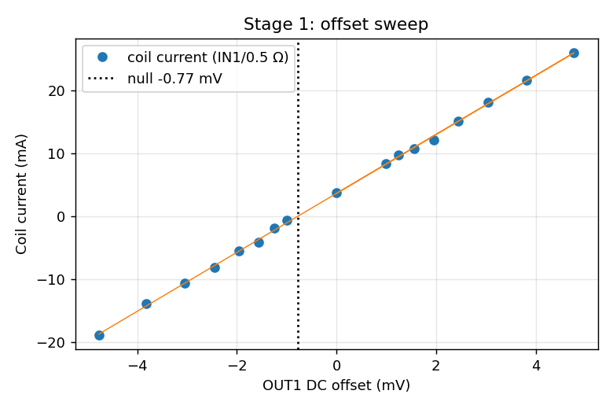</a><br>1 · output current vs OUT1 offset; null at −0.79 mV</td>
<td width="50%"><a href="characterization/2026-11-05_stage1_zero/spectra.png">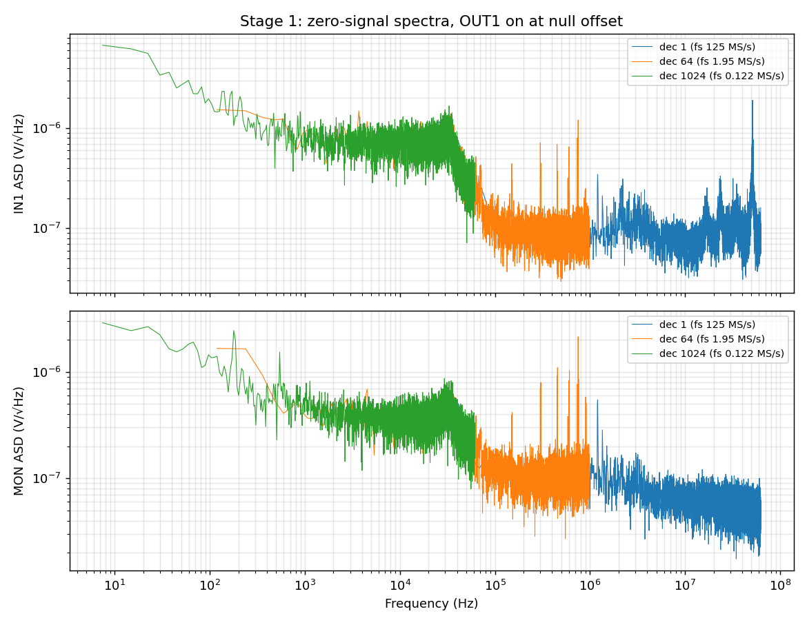</a><br>1 · spectra at zero output: no oscillation; 51.5 MHz pickup, 751 kHz line</td>
</tr>
<tr>
<td><a href="characterization/2026-11-05_stage2_gain/gain.png">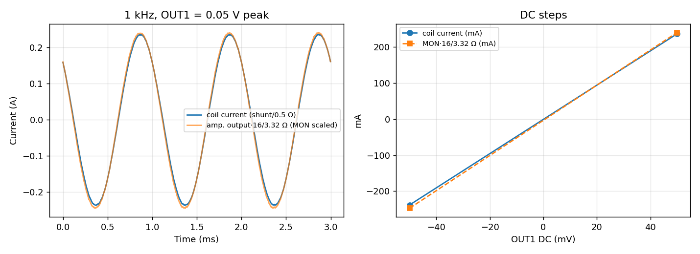</a><br>2 · gain at 1 kHz and DC</td>
<td><a href="characterization/2026-11-06_stage3_impedance_dense/impedance.png">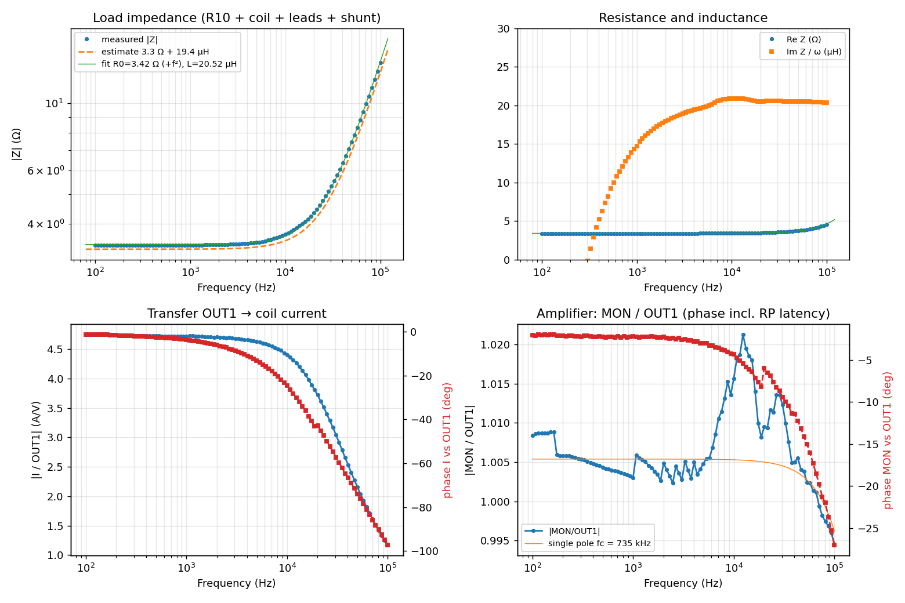</a><br>3 · load impedance and I/OUT1, 0.2 A (superseded by the 9 Nov frequency response)</td>
</tr>
<tr>
<td><a href="characterization/2026-11-05_stage4_step/step.png">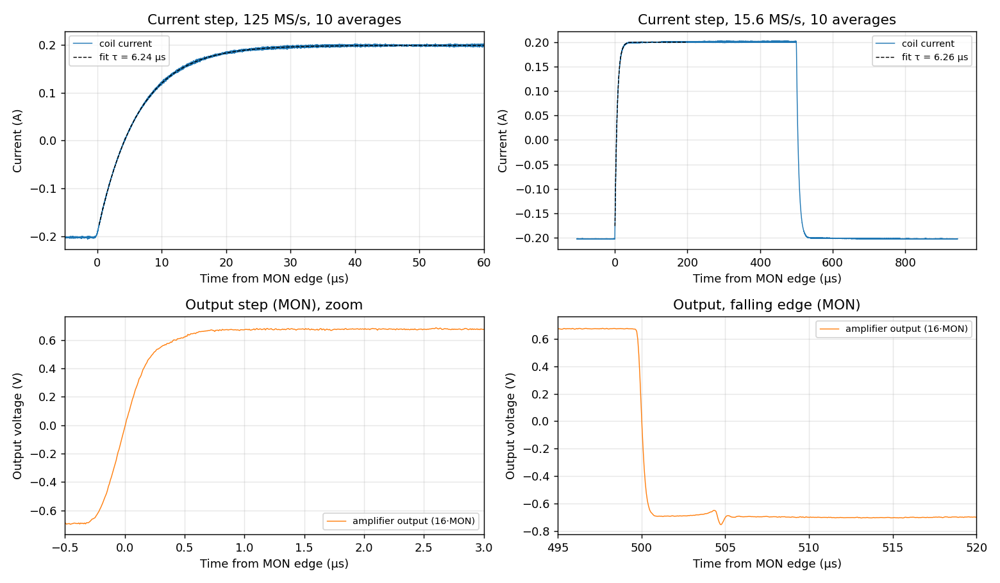</a><br>4 · step response: current τ 6.24 µs, output 0.46 µs</td>
<td><a href="characterization/2026-11-06_stage5_linearity_dense/linearity.png">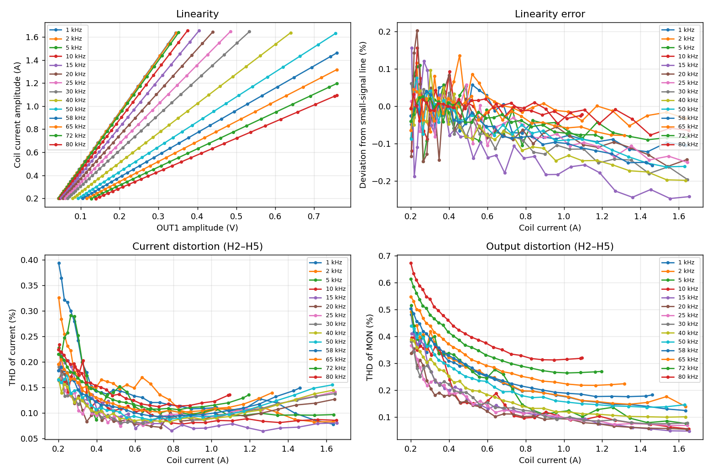</a><br>5 · linearity and THD vs amplitude, 1–80 kHz</td>
</tr>
<tr>
<td><a href="characterization/2026-11-06_stage5_linearity_dense/waveforms_top.png">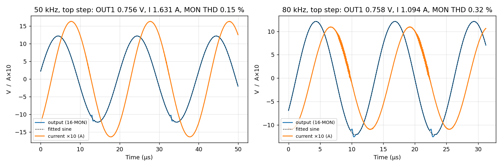</a><br>5 · waveforms at the largest clean amplitude; right: HF noise on the current at 80 kHz</td>
<td><a href="characterization/2026-11-06_stage6_dc_dense/dc_linearity.png">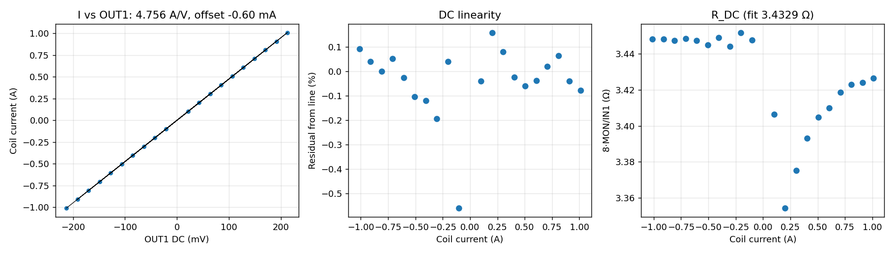</a><br>6 · DC linearity ±0.1…±1 A</td>
</tr>
<tr>
<td><a href="characterization/2026-11-06_stage7_thermal_dense/thermal.png">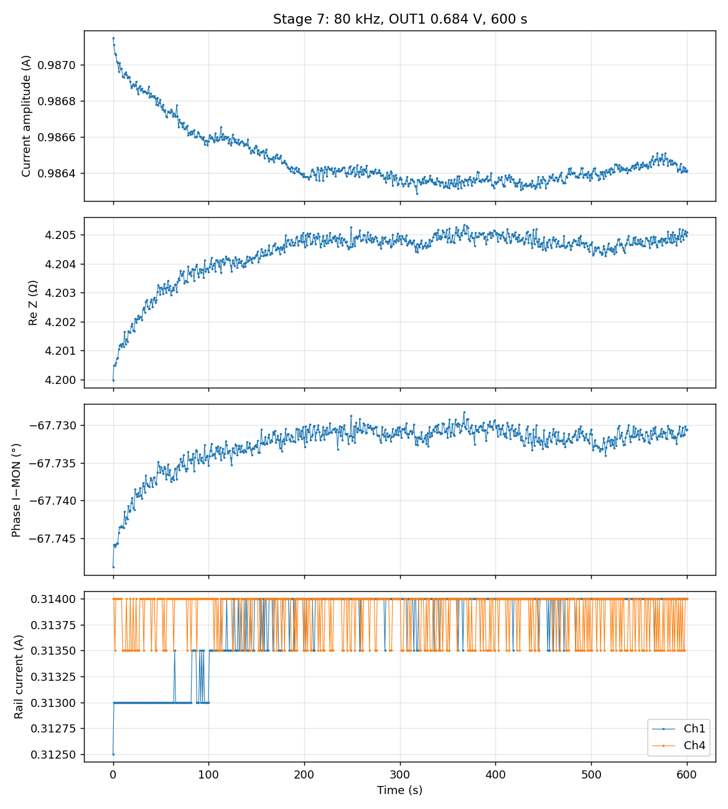</a><br>7 · 10 min at 0.99 A, 80 kHz</td>
<td><a href="characterization/2026-11-06_stage8_noise_dense/noise.png">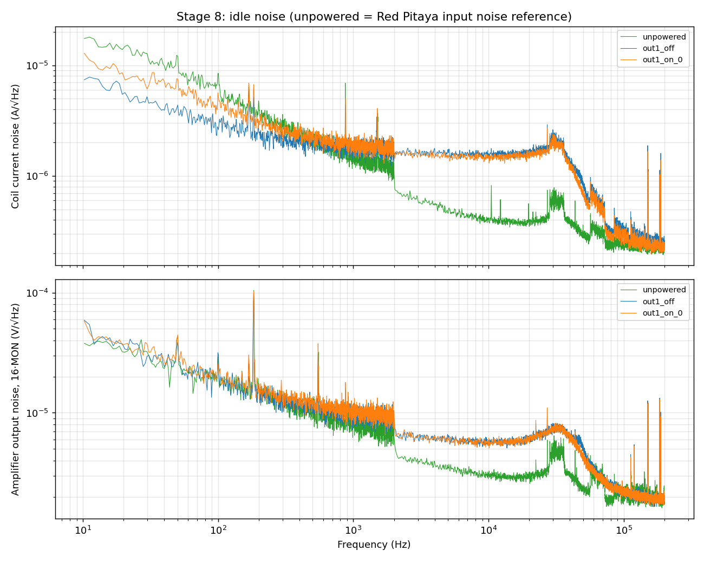</a><br>8 · current noise at zero output vs the Red Pitaya floor</td>
</tr>
</table>

The frequency response replaces the stage 3 table:
- below 3 kHz, stage 3 had ~0.9° too much lag;
- its |Z| was 1–1.5 % low;
- at 1 Hz the new data meets the DC values within 0.1 %.

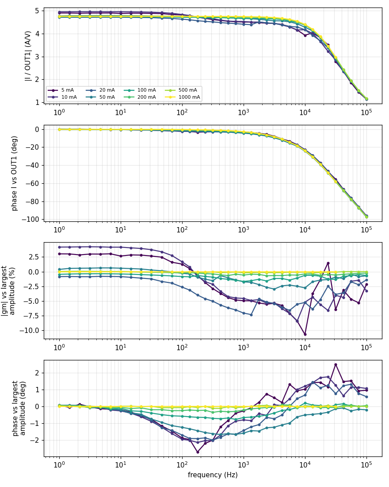

*Top two panels: |I/OUT1| and phase for each amplitude. Bottom two: the same relative to the
largest amplitude at each frequency. Below ~100 mA the shunt-based values move by several % and
up to 2.7°; from 0.5 A up they agree.*
